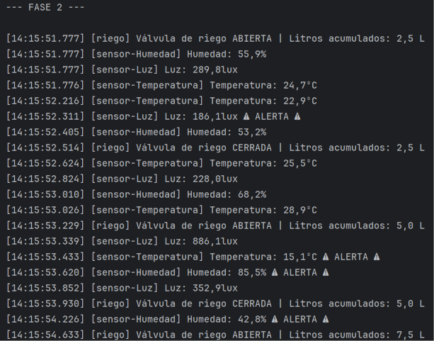
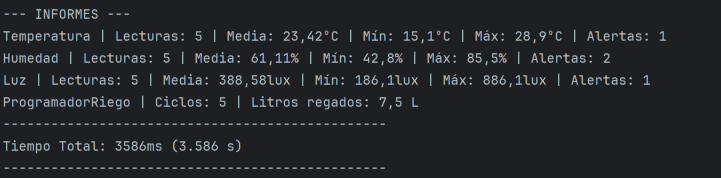

# Invernadero con hilos

---
## Qué hace
Este proyecto monitorea y controla de forma automática un invernadero. En ete invernadero contamos con varios dispositivos que trabajan simultáneamente. Estos serían:
- **Sensor de Temperatura** (400 ms)
- **Sensor de Humedad** (600 ms)
- **Sensor de Luz** (500 ms)
- **Programador de Riego** (700 ms)
---
## Cómo ejecutarlo
Clonamos el proyecto de GitHub y lo abrimos en INtelliJ IDEA. Una vez con el programa esta tenemos que ejecutarlo por las 4 fases que componen el proyecto:

- **Fase1_Secuencial.java:** Ejecuta el programa de forma secuencial, es decir, que el programa pasa al siguiente todas las tareas en un solo hilo.
- **Fase2_Concurrente.java:** Ejecuta el programa de forma concurrente, es decir, se dividen las tareas a un hilo por tarea.
- **Fase3_Experimentos.java:** Ejecutamos unos experimentos donde detallamos más adelante.
- **Fase4_Vigilante.java:** Creamos un nuevo hilo demonio que monitoriza los estados de los demás hilos. 

---
## Captura

---
## Resultados

| Fase   | Tiempo total (ms) | Tiempo total (s) | N.º de hilos activos | Tipo de ejecución |
|--------|-------------------|------------------|----------------------|-------------------|
| Fase 1 | 11217 ms          | 11.217 s         | 1 hilo               | Secuncial         |
| Fase 2 | 3585 ms           | 3.585 s          | 4 hilos              | Concurrente       |

---
## Análisis
### ¿Por qué compensa usar hilos en el invernadero?
En este proyecto las fases 1 y d2 realizan las mismas tareas pero con una diferencia clave. La fase 1 la realiza de forma secuencial y la fase 2 la rea liza de forma concurrente.

La Fase 1 consiste en un modelo secuencial, es decir, el programa utiliza un único hilo para realizar todas las tareas y hasta que no termina una no continua la siguiente. Esto provoca que mientras se realiza una lectura de un sensor los demás están bloqueados hasta que le toque la tarea. Por ello el tiempo de finalización sería la suma de todas la suma de todas las tareas.

$$\text{Tiempo Total} = (5\times 400\text{ ms}) + (5\times 600\text{ ms}) + (5\times 500\text{ ms}) + (5\times 700\text{ ms}) = 2000 + 3000 2500 + 3500 = 11000\text{ ms}$$

La Fase 2 consiste en un modelo concurrente, es decir, el programa asigna un hilo para cada sensor y al programador de riego. Esto lo que realiza es que las tareas se inician simultáneamente y avanzan en paralelo, por lo que cuando un sensor realiza una pausa el programa continúa con otro hilo. Esto provoca que el tiempo total sea el tiempo que tarde el hilo más lento.

En conclusión, utilizar multiples hilos nos ayuda de optímizar las tareas que de lo contrario nos tomara más tiempo. Esto lo podemos ver más claro en el punto anterior en la tabla de resultado de las dos Fases.

### Experimentos A, B y C
Los experimentos realizados en el Fase 3:

#### Experimento A
*Lanza un sensor en un hilo e imprime su informe() sin
esperar. Después espera y vuelve a imprimirlo.*

- **Qué pasó:**
  La primera vez podemos ver que los números impresos eran 0 con la excepción de los valores Min y Max que muestran números extremos esto es porque lo establecimos en el programa.

La segunda vez se mostró correctamente todas las lecturas correctamente.

- **Por qué:**
  Esto es porque el programa no le ha dado tiempo a realizar ninguna medición por lo que solo nos muestra los valores determinados, pero cuando hacemos que continue el programa con el join() este puede continuar con las mediciones.

#### Experimento B
*Crea un riego de 3 ciclos y llama a riego.run() en vez de
riego.start(). Mide cuánto tarda y muestra
riego.getState() al final.*

- **Qué pasó:**
Al ejecutar run() se ejecutan los 5 ciclos de riego un tras otro de forma secuencial, pero al final con al ejecutar el getState() nos muestra el estado del objeto que es *NEW*.
- **Por qué:**
Al invocar directamente run() no crea ni arrastra ningún hilo por lo que el objeto Thread no llego a iniciarse por lo que sigue manteniendo el estado inicial de *NEW*

#### Experimento C
*Arranca un riego, espera a que termine y vuelve a llamar a
start() sobre el mismo objeto.*

- **Qué pasó:**
Realizamos un start(), inicia el ciclo hasta completarlo, una vez terminado realizamos un segundo start() y salta una excepción.
- **Por qué:**
La exceptión saleta porque un hilo una vez eliminado no se puede volver a ejecutar.

### Estados observados

| Estado       | Cuando ocurre                                                                                      | Que línea de código                                   |
|--------------|----------------------------------------------------------------------------------------------------|-------------------------------------------------------|
| NEW          | El objeto esta instanciado pero no iniciado.                                                       | Thread hiloLuz = new Thread(luz, "sensor-Luz");       |
| RUNNABLE     | EL hilo se esta ejecutando o esta listo para ejecuatarse                                           | hiloLuz.start();                                      |
| TIME_WAITING | El hilo pausa voluntariamente su ejecución durante un tiempo detarminado                           | Thread.sleep(periodo);                                |
| WAITING      | EL hilo principal o vigilante esperan indefinidamente a que otro hilo termine                      | hiloLuz.join();                                       |
| BLOCKED      | En nuestro proyecto no se utiliza, pero ocurre cuando un hilo espera un cerrojo de sincreonización | No hay codigo porque no lo usamos en nuestro proyecto |
| TERMINATED   | El hilo ha completado todas sus tareas.                                                            | No utiliza codigo para terminar los hilos.            |

***¿Por qué termina el programa si el vigilante sigue en su bucle?***
El hilo vigilante está configurado como un hilo demonio, estos son hilos de segundo plano que fueron diseñados únicamente para dar soporte o monitorizar otras tareas. 

Al estar diseñado como un soporte una vez que todas las tareas de sensor y riego llegan al estado **TERMINATED** y solo quedan los hilos demonios automáticamente finaliza el proceso, esto lo realiza ignorando el bucle en el que se encuentra y liberando los recursos.

### Thread frente a Runnable

| Aspecto         | Thread                                | Runnable                                                                        |
|-----------------|---------------------------------------|---------------------------------------------------------------------------------|
| Representación  | El objeto es el hilo que se ejecuata. | El objeto es la tarea que se ejecuta, no el hilo.                               |
| Herencia        | No premita la herencia múltiple.      | Podemos heredar de otro clase en nuestro proyecto lo usamos en la clase Sensor. |
| Arrancar        | Utilizando start() sobre el objeto.   | Requiere un Thread pasando la tarea en un constructor                           |
| Nombre del hilo | Heredado del método getName()         | Través de la llamada éstatica Thread.currentThread().getName().                 |

***¿Por qué los sensores SOLO pueden ser Runnable en tu diseño?***

Principalmente, porque Thread no permite las herencias multiples y en este trabajo necesitábamos los constructures realizado en la clase abstracta de Sensor. 

Por eso necesitábamos utilizar el recurso Runnable.

***¿Qué forma elegirías para el riego y por qué?***

En nuestro proyecto utilizamos Thread, pero una forma más limpia seria realizar utilizar un Runnable. 

Esto es debido a que en el futuro si necesitamos la misma construction podemos heredarla en el futuro. 
